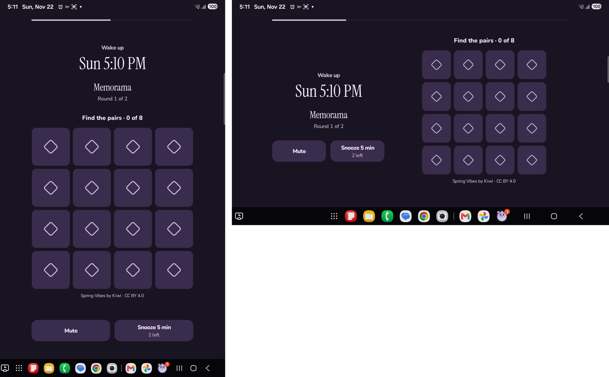

# Bimbi · Cómo se implementó y validó la Fase 4

La Fase 4 se trabajó el 22 de noviembre de 2026 en la rama `codex/phase4-alarms`. Se hizo en tres etapas: alarmas nativas con retos (commit `82592d9`), sonidos configurables y posposiciones por ocurrencia (commit `19c5748`), y el ajuste final de la distribución visual de los retos. El resultado son varias alarmas locales con repetición semanal que suenan sin conexión y sobre la pantalla bloqueada. Para apagarlas hay que completar un reto de Agitar, Matemáticas, Ball Monte, Follow the pattern o Memorama, cada uno con cuatro dificultades. [Informe de cierre](REPORT.md) · [Sonidos y posposiciones](ALARM_SOUNDS.md) · [Registro de comandos](checks.txt)

## 1. Partir de la Fase 3 y decidir dónde vive la alarma

Se partió del cierre de la Fase 3 (`cf34fd4`). En la Fase 1 la alarma era un experimento con un solo registro pendiente y un intervalo fijo. En la Fase 4 se necesitaba un catálogo de alarmas con hora local, días, reto y dificultad. Se decidió que **Android sea la única fuente de verdad**. El catálogo, las ocurrencias activas y las posposiciones se guardan en el almacenamiento privado de la app y los usan el receptor, el servicio y Flutter. Así la alarma suena aunque Flutter no esté abierto y sin depender de Firebase. [Implementación de la Fase 3](../phase3/IMPLEMENTACION_FASE_3.md) · [Arquitectura](../../ARCHITECTURE.md)

| Pieza | Archivo | Responsabilidad |
|---|---|---|
| Modelo | `android/app/src/main/kotlin/com/bimbi/app/LocalAlarm.kt` | Alarma, ocurrencia (episodio), posposición y catálogo completo (`AlarmBook`). |
| Almacenamiento | `android/app/src/main/kotlin/com/bimbi/app/AlarmStore.kt` | Lee y escribe el catálogo en JSON dentro de `SharedPreferences` privadas. |
| Motor | `android/app/src/main/kotlin/com/bimbi/app/AlarmEngine.kt` | Guarda, programa con `AlarmManager`, restaura, dispara y pospone. |
| Servicio | `android/app/src/main/kotlin/com/bimbi/app/AlarmService.kt` | Servicio en primer plano: audio, notificación y sesión del reto. |
| Reto | `android/app/src/main/kotlin/com/bimbi/app/WakeSession.kt` | Rondas, tableros, ventana de 15 segundos y retroceso. |
| Vista | `android/app/src/main/kotlin/com/bimbi/app/AlarmActivity.kt` y `WakeRoundView.kt` | Pantalla nativa del reto y sus tableros. |
| Puente | `android/app/src/main/kotlin/com/bimbi/app/MainActivity.kt` y `lib/core/platform.dart` | Canales entre Flutter y Android. |

## 2. Modelar alarmas, ocurrencias y posposiciones

En `LocalAlarm.kt` cada alarma tiene un identificador estable, etiqueta, hora y minuto locales, días activos (0 = lunes), reto, dificultad, sonido y estado (`armed`, `exact`, `notifications`, `missed`, etc.). `firstAfter()` calcula la siguiente ocurrencia con `java.time` en la zona del dispositivo. Al pasar al horario de verano, la hora inexistente avanza la duración del salto. Al volver al horario normal, se usa la primera de las dos horas repetidas. Una alarma sin días suena una vez y una alarma semanal salta el día que ya sonó (`lastFiredDay`). [Modelo](../../../android/app/src/main/kotlin/com/bimbi/app/LocalAlarm.kt)

Cuando una ocurrencia suena se crea un `AlarmEpisode` con su propio identificador, su reto y su contador de dos posposiciones. `postpone()` suma cinco minutos y guarda la hora absoluta y el tiempo monotónico del arranque. Si el dispositivo no se reinicia, la posposición se calcula con el reloj monotónico aunque el usuario cambie la hora. `AlarmBook.active` elige el episodio más antiguo que no está pospuesto, de modo que las alarmas simultáneas esperan su turno. [Modelo](../../../android/app/src/main/kotlin/com/bimbi/app/LocalAlarm.kt) · [Almacenamiento](../../../android/app/src/main/kotlin/com/bimbi/app/AlarmStore.kt)

```kotlin
fun postpone(at: Long, elapsed: Long, boot: Int): AlarmEpisode? {
    if (isTest || snooze != null || snoozesLeft <= 0) return null
    return copy(snoozes = snoozes + 1, snooze = SnoozeTime(at + SNOOZE_MS, elapsed + SNOOZE_MS, boot))
}
```

## 3. Programar cada ocurrencia exacta y restaurarla

`AlarmEngine.saveDraft()` valida el borrador, calcula la siguiente ocurrencia y la registra con `AlarmManager.setAlarmClock()`. Cada `PendingIntent` lleva en su URI el tipo (`regular`, `snooze` o `test`), el identificador y la hora. Así se puede cancelar o reemplazar una ocurrencia sin afectar a las demás. Antes de programar se comprueban el permiso de alarmas exactas y las notificaciones. Si falta alguno, la alarma queda guardada como bloqueada y Flutter muestra cómo resolverlo. [Motor](../../../android/app/src/main/kotlin/com/bimbi/app/AlarmEngine.kt)

`AlarmReceiver` recibe el disparo, compara la hora con el registro actual y llama a `fire()`. `fire()` crea el episodio, programa la siguiente repetición y arranca `AlarmService`. `RestoreReceiver` vuelve a programar las ocurrencias futuras tras reiniciar y desbloquear, actualizar la app, cambiar la hora o la zona horaria, o recuperar el permiso de alarmas exactas. El manifiesto añade `TIME_SET` y `TIMEZONE_CHANGED`. Una alarma de una sola vez que no pudo sonar mientras el equipo estaba apagado queda marcada como perdida y no se reproduce tarde. `migrate()` convierte la alarma de la Fase 3 al nuevo catálogo y conserva su próxima ocurrencia. [Receptores y migración](../../../android/app/src/main/kotlin/com/bimbi/app/AlarmEngine.kt) · [Manifiesto](../../../android/app/src/main/AndroidManifest.xml)

## 4. Mantener el reto vivo en un servicio en primer plano

`AlarmService` es dueño del audio y de la sesión del reto, no la pantalla. Si el usuario sale de la vista, el reto y el sonido continúan. El servicio publica una notificación de prioridad alta con **Open challenge** y una intención de pantalla completa para que `AlarmActivity` aparezca sobre la pantalla bloqueada. Si Android niega la pantalla completa, queda la notificación como alternativa. Un latido periódico revisa el plazo de inactividad y mantiene el dispositivo despierto mientras hay un reto activo. [Servicio](../../../android/app/src/main/kotlin/com/bimbi/app/AlarmService.kt)

La regla de la ventana de 15 segundos vive en `WakeSession`. Cada toque, clic, acción de TalkBack o tecla llama a `interact()` y renueva el plazo. Si el plazo vence, `tick()` retrocede una ronda por cada ventana vencida, quita el silencio y genera un tablero nuevo. [Estado del reto](../../../android/app/src/main/kotlin/com/bimbi/app/WakeSession.kt)

```kotlin
if (expires != null && now >= expires) {
    val windows = (now - expires) / ACTIVE_WINDOW_MS + 1
    round = maxOf(1, round - minOf(windows, round.toLong()).toInt())
    muted = false
    deadline = expires + windows * ACTIVE_WINDOW_MS
    reset("Time ran out. Round $round restarted.")
}
```

**Snooze 5 min** llama a `AlarmEngine.snooze()`. Ese método registra la nueva alarma exacta **antes** de guardar el episodio pospuesto. Si el registro falla, cancela lo programado y el reto sigue sonando. Al completar la última ronda, `complete()` retira el episodio y el servicio detiene audio y notificación. [Motor](../../../android/app/src/main/kotlin/com/bimbi/app/AlarmEngine.kt)

## 5. Construir los cinco retos con cuatro dificultades

`WakeDifficulty` define en una sola tabla cuántas agitaciones, operaciones, vasos, intercambios, casillas del patrón y parejas usa cada nivel (`easy`, `normal`, `difficult`, `extreme`). `newBoard()` genera cada ronda al azar. [Retos y dificultades](../../../android/app/src/main/kotlin/com/bimbi/app/WakeSession.kt)

| Reto | Cómo se resuelve | Detalle de implementación |
|---|---|---|
| Agitar | 15 a 50 movimientos según el nivel. | `ShakeDetector` en `AlarmActivity.kt` cuenta un movimiento cuando la aceleración se aleja de la gravedad y vuelve a la calma. Si no hay acelerómetro, cambia a Matemáticas. |
| Matemáticas | 2 a 5 operaciones. | Campo numérico y **Check answer**. Las operaciones también se leen en TalkBack ("40 minus 12"). |
| Ball Monte | Seguir la bola entre 3 y 6 vasos. | Los vasos se animan con traslaciones. Un vaso incorrecto repite la ronda a la misma velocidad. |
| Follow the pattern | Repetir una secuencia en una cuadrícula de 3 × 3 a 6 × 6. | Primero se muestra la secuencia y luego se toca en orden. Un error la vuelve a mostrar. |
| Memorama | Encontrar de 3 a 8 parejas. | Las cartas se muestran 2.5 s, luego se voltean. Las parejas encontradas quedan en lila. |

Con TalkBack activo, Ball Monte, el patrón y Memorama muestran **Use math challenge**, porque dependen de la vista. Cada casilla tiene una descripción ("Row 2, column 3, highlighted", "Card 4, daisies, matched"). [Tableros](../../../android/app/src/main/kotlin/com/bimbi/app/WakeRoundView.kt) · [Vista del reto](../../../android/app/src/main/kotlin/com/bimbi/app/AlarmActivity.kt)

## 6. Conectar Flutter con el catálogo nativo

`MainActivity` expone en el canal `com.bimbi.app/platform` los métodos `saveAlarm`, `enableAlarm`, `deleteAlarm`, `openChallenge`, `previewAlarmSound` y los accesos a los ajustes de permisos. El canal de eventos `com.bimbi.app/alarms` avisa a Flutter cuando Android cambia el catálogo. `AndroidPlatform` en Dart traduce esas llamadas y `capabilitiesProvider` vuelve a leer el catálogo. [Puente Android](../../../android/app/src/main/kotlin/com/bimbi/app/MainActivity.kt) · [Adaptador Dart](../../../lib/core/platform.dart)

En Flutter, `AlarmDraft` y `NativeAlarm` representan el borrador y la alarma guardada. `AlarmActions` agrupa guardar, activar y borrar. El editor obliga a elegir un reto antes de guardar (**No mission** deja el botón desactivado) y empieza en **Normal**. **Alarms** muestra la lista, la próxima alarma y el botón **Open wake-up challenge** mientras hay un reto activo. [Estado del editor](../../../lib/features/alarm/application/alarm_draft.dart) · [Editor](../../../lib/features/alarm/presentation/alarm_editor.dart) · [Selector de retos](../../../lib/app/design_system/components/alarm_parts.dart) · [Inicio](../../../lib/ui/home/widgets/home_screen.dart) · [Modelo del inicio](../../../lib/ui/home/view_models/home_view_model.dart)

## 7. Añadir sonidos configurables y posposiciones por ocurrencia

En la segunda etapa cada alarma recibió tono, volumen de 20 a 100 % e intensidad (**Softest**, **Normal**, **Noisy**, **Heavy** y **Jackhammer**). `AlarmSound` guarda la configuración. `AlarmAudio` prepara el reproductor en el canal de alarma y usa `LoudnessEnhancer` para los niveles altos. La vista previa del editor y la alarma real usan el mismo código. Los cuatro tonos propios (**Dawn Chime**, **Soft Bells**, **Morning Pulse** y **Bright Signal**) se generan con un script y funcionan sin conexión. [Modelo de sonido](../../../android/app/src/main/kotlin/com/bimbi/app/AlarmSound.kt) · [Reproducción](../../../android/app/src/main/kotlin/com/bimbi/app/AlarmAudio.kt) · [Generador de tonos](../../../scripts/generate_alarm_sounds.py) · [Tonos](../../../android/app/src/main/res/raw/)

En esta etapa también se ajustó el contador de posposiciones para que pertenezca a cada ocurrencia y no a la alarma. Una alarma de lunes y martes a las 7:00 empieza cada mañana con dos posposiciones. Otra alarma que suene mientras la primera está pospuesta tiene su propio contador. Las alarmas antiguas sin sonido usan el tono de Android al 100 % con intensidad **Normal**. [Guía de sonidos](ALARM_SOUNDS.md)

## 8. Probar la lógica antes del dispositivo

Se añadió JUnit a `android/app/build.gradle.kts` y `scripts/check.sh` ejecuta `./gradlew :app:testDebugUnitTest`. Las 12 pruebas JVM cubren: [Pruebas del reto](../../../android/app/src/test/kotlin/com/bimbi/app/WakeSessionTest.kt) · [Pruebas del modelo](../../../android/app/src/test/kotlin/com/bimbi/app/LocalAlarmTest.kt)

- la actividad a los 14 segundos renueva el plazo sin cambiar de ronda;
- el vencimiento en la ronda 3 regresa a la 2, con o sin silencio;
- los cinco retos terminan en los cuatro niveles;
- un vaso incorrecto o un patrón erróneo se repite en orden;
- las fechas locales con cambios de horario y las alarmas de una sola vez;
- dos posposiciones por ocurrencia, el caso lunes–martes y los valores seguros del sonido.

En Flutter se actualizaron `FakePlatform` y las pruebas del editor: crear una alarma exige un reto, el día y la dificultad se guardan con valores estables, y la vista previa de sonido funciona a 360 dp con texto al 200 %. Se regeneraron las referencias visuales de **Alarms**. [Plataforma de prueba](../../../test/helpers/fake_platform.dart) · [Pruebas de widgets](../../../test/widget_test.dart) · [Pruebas del borrador](../../../test/unit/alarm_draft_test.dart)

```sh
./scripts/check.sh
```

## 9. Verificar en emuladores y en la Galaxy Tab A9

| Escenario | Qué se hizo |
|---|---|
| Migración | En el emulador de 412 dp, la alarma de la Fase 3 conservó su próximo disparo y pasó a **Math · Normal**. Al quitar y devolver el permiso de alarmas exactas, la alarma se bloqueó y luego se volvió a registrar. |
| Sin conexión | En el emulador de 360 dp y en la tablet, con modo avión y sin Wi-Fi, la alarma sonó con el proceso terminado y la pantalla bloqueada. |
| Ventana de 15 s | Con silencio, la ronda 3 pasó a la 2 y el audio volvió. Sin silencio, el siguiente vencimiento regresó a la ronda 1. |
| Posposiciones | Tras dos posposiciones, el botón quedó desactivado y completar el reto retiró la alarma. |
| Reinicio | Tras reiniciar la tablet, Android restauró una alarma de **Shake · Easy**. El propietario la pospuso, volvió a sonar a los cinco minutos y la terminó con 15 movimientos. |
| Accesibilidad | Con TalkBack se leyeron los retos, las dificultades y **Use math challenge**. Con texto al 200 % se revisó el patrón de 6 × 6 a 360 dp y Ball Monte con seis vasos a 412 dp. |

Al terminar cada prueba se restauraron la conexión, el permiso de pantalla completa y la orientación de la tablet. [Resultados detallados](REPORT.md#verificación)

## 10. Corregir la distribución visual de los retos

Durante la revisión en la tablet el propietario detectó que los retos se veían desproporcionados en vertical y horizontal. Los botones tenían tamaños distintos, las fuentes competían entre sí y los símbolos de Memorama eran básicos. Se pidió corregir la distribución y las fuentes, igualar los botones y usar el paquete [Spring Vibes](https://icon-icons.com/es/pack/spring-vibes/2573) para Memorama.

Se trabajó así:

1. **Distribución.** En vertical, la información, el tablero y los botones comparten una columna centrada de hasta 432 dp. En horizontal (desde 740 dp de ancho), la información y los botones van a la izquierda y el reto a la derecha, en proporción 2:3. `CappedColumn` limita el ancho de cada columna. [Vista del reto](../../../android/app/src/main/kotlin/com/bimbi/app/AlarmActivity.kt) · [Tableros](../../../android/app/src/main/kotlin/com/bimbi/app/WakeRoundView.kt)
2. **Fuentes.** Se ordenó la jerarquía: nombre de la alarma en Nunito ExtraBold de 15 sp, hora en Instrument Serif de 44 sp, nombre del reto en Instrument Serif de 26 sp y ronda en Nunito de 14 sp. Los colores salen de `colors.xml`, que replica la paleta de Flutter. [Colores nativos](../../../android/app/src/main/res/values/colors.xml)
3. **Botones.** `button()` define un solo estilo: 56 dp de alto, esquinas de 16 dp y Nunito ExtraBold de 15 sp. Mute y Snooze comparten el mismo ancho. El campo de respuesta y **Check answer** de Matemáticas miden lo mismo que esa fila (`controlWidth`). **Check answer** va relleno en lila porque es la acción principal.
4. **Tableros que caben en pantalla.** Las casillas se calculan según el ancho disponible. Después de cada distribución, si la página es más alta que el área visible, `fit()` reduce las casillas lo justo para que Mute y Snooze sigan visibles, sin bajar de 48 dp. Al rotar se recalcula desde el tamaño máximo. Hubo que forzar que las filas del tablero volvieran a medirse, porque Android reutilizaba su medida anterior.
5. **Memorama.** Se incorporaron ocho ilustraciones sin modificar de Spring Vibes de Kiwi en `android/app/src/main/res/drawable-nodpi/memorama_*`. La licencia CC BY 4.0 exige atribución, así que el reto muestra "Spring Vibes by Kiwi · CC BY 4.0" y `res/raw/memorama_artwork_notice.txt` guarda la fuente, el autor y los identificadores. [Aviso de atribución](../../../android/app/src/main/res/raw/memorama_artwork_notice.txt) · [ADR de recursos](../../adr/008-design-assets.md)

Para revisar cada reto sin esperar a una alarma real, se insertó en el almacenamiento de la app de depuración un episodio de prueba silencioso. Se hizo con `adb shell run-as com.bimbi.app`, después de respaldar el catálogo del propietario. El reto se abrió desde **Open wake-up challenge** y se fotografió en vertical y horizontal. Al terminar se restauraron el catálogo, el volumen de alarma y la rotación automática. Se comprobó que las alarmas del propietario volvieran a quedar programadas.



[Pareja encontrada](tab-a9-memorama-matched.png) · [Patrón](tab-a9-pattern.png) · [Ball Monte](tab-a9-ball-monte.png) · [Matemáticas](tab-a9-math.png) · [Agitar](tab-a9-shake.png) · [Patrón de 6 × 6 ajustado en un teléfono de 412 dp](phone-412-pattern-fit.png)

## 11. Compilar, comprobar y documentar

La comprobación final terminó con análisis limpio, 71 pruebas de Flutter y 12 pruebas JVM de Android. En la etapa de alarmas, la compilación de desarrollo se copió a `build/review`, se verificó su firma y se registró su SHA-256. La versión con la nueva distribución se instaló como actualización desde `build/app/outputs/flutter-apk/app-debug.apk` y todavía no tiene una copia de entrega con su SHA-256. [Resultados](checks.txt)

```sh
flutter analyze --fatal-infos
flutter test
(cd android && ./gradlew :app:testDebugUnitTest)
flutter build apk --debug --no-pub --dart-define-from-file=config/dev.json
apksigner verify build/review/bimbi-phase4-debug.apk
shasum -a 256 build/review/bimbi-phase4-debug.apk
```

Se actualizaron la arquitectura, las limitaciones, el estado de las fases, el registro de cambios y la decisión sobre recursos de diseño. Las limitaciones que quedan para la Fase 5 son las siguientes. Android controla el volumen final, la entrega de notificaciones y la detención forzada de la app. La recuperación tras reinicio ocurre después del primer desbloqueo. Si Android termina el proceso del servicio, la ronda vuelve a empezar al reabrir el reto. [Arquitectura](../../ARCHITECTURE.md) · [Limitaciones](../../LIMITATIONS.md) · [Estado de las fases](../../decisions/gates.md) · [Registro de cambios](../../../CHANGELOG.md)
